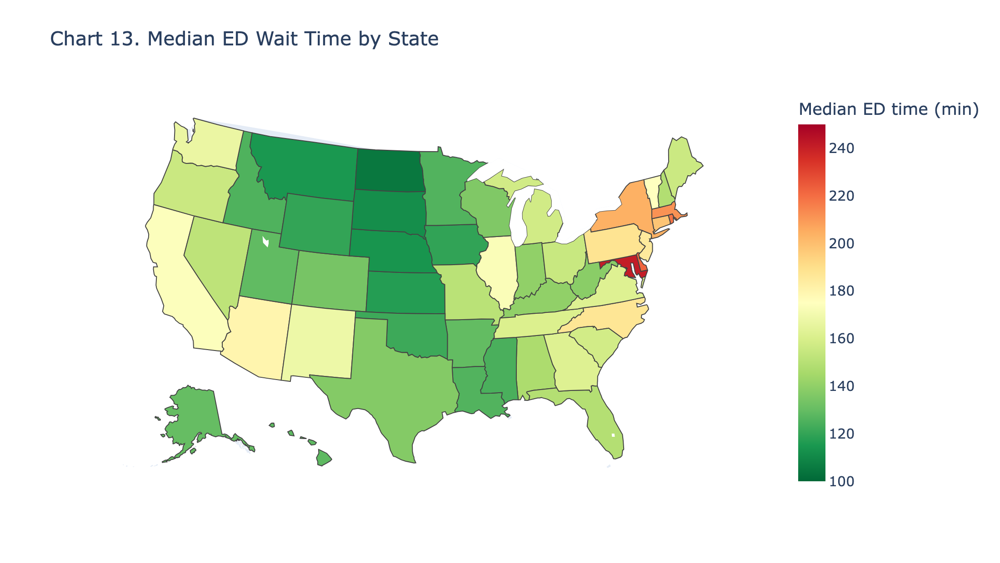
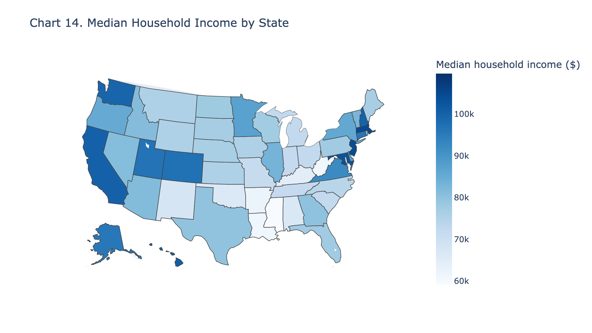
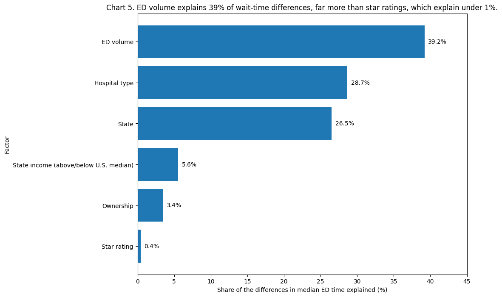
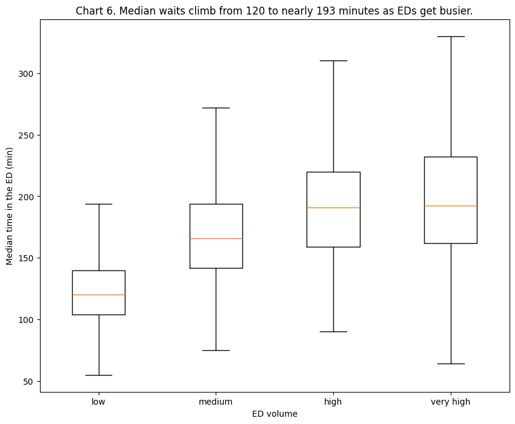
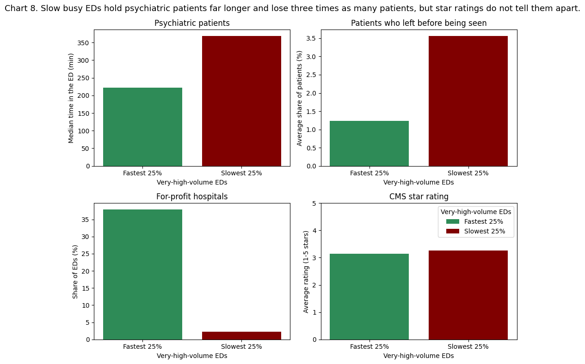
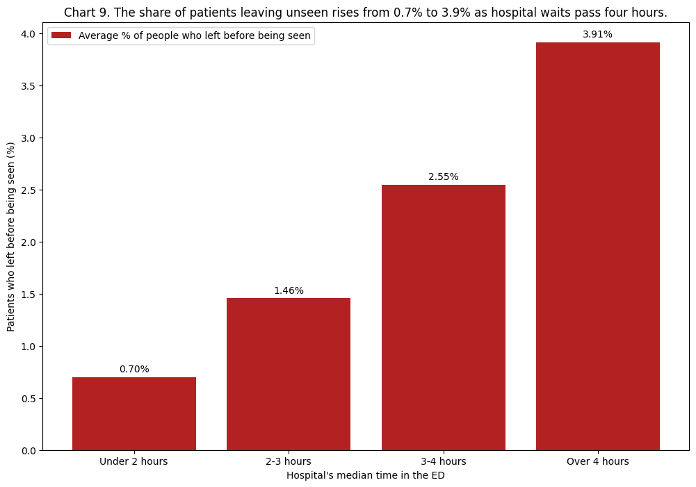
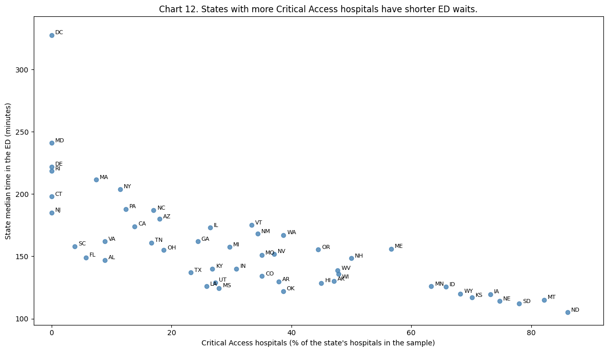
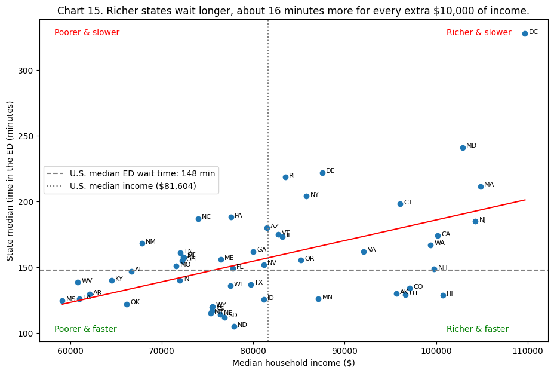

# What Drives Emergency Department Wait Times Across U.S. Hospitals?

**BA780 Introduction to Data Analytics · Boston University MSBA · Cohort A · Team 4**

[](https://colab.research.google.com/github/Hassan02052002/ba780-er-wait-times/blob/main/A04-What-Drives-ER-Wait-Times.ipynb)


At some U.S. hospitals a typical emergency department (ED) visit takes under two hours; at others it takes more than five. This project combines three public government datasets on **4,080 hospitals** to find out **why some EDs are so much slower than others**, who pays the price for long waits, and what hospitals and state health departments can do about it.

<p align="center">
  
  
</p>
<p align="center"><em>Median ED wait time (left) and median household income (right) by state. The richest states are among the slowest.</em></p>

---

## Key findings

| | Finding |
|---|---|
| 🏥 **The hospital** | **ED volume** is the strongest driver of wait times, explaining **39%** of the differences between hospitals; **star ratings explain under 1%**. Median waits rise from **120 minutes** at low-volume EDs to **192.5** at very-high-volume EDs, where **1 in 5** EDs has a typical visit over four hours. |
| ⚡ **Fast vs. slow busy EDs** | Among the busiest EDs, the slowest quarter keeps psychiatric patients far longer (**368 vs. 222 minutes**), loses **3x as many patients** before they are seen and is rarely for-profit (2% vs. 38%), while star ratings are the same. |
| 🚶 **The patients** | The share of patients who **leave before being seen** rises from **0.7%** at EDs under two hours to **3.9%** at EDs over four hours. Psychiatric and transferred patients wait the longest. |
| 🏢 **Owners and rural states** | At very high volume, **for-profit EDs are about an hour faster**. States that rely on small rural **Critical Access hospitals** have the shortest waits (r = −0.72). |
| 💵 **The economy** | **Richer states wait longer, not shorter:** about **+16 minutes per $10,000** of median household income. Rurality explains far more (R² rises from 0.26 to 0.72). |
| 🔍 **Case study** | **Massachusetts vs. Minnesota:** similar economies, opposite waits (211.5 vs. 126 minutes). Massachusetts is slower than the U.S. at every ED size, and at two of its EDs psychiatric patients stay **12.7–14 hours**. |

### Estimated impact

- **~48 minutes saved per visit** if the slower half of very-high-volume EDs reached the typical busy-ED wait (351 EDs).
- **~116,000 patients a year** kept from leaving unseen if the busiest EDs over four hours moved into the 3–4 hour band (a conservative estimate).
- **~25 minutes saved per psychiatric patient** if busy EDs had the same psychiatric gap as small EDs.

---

## Selected charts

<table>
  <tr>
    <td></td>
    <td></td>
  </tr>
  <tr>
    <td align="center"><em>Chart 5. Which factor explains the most?</em></td>
    <td align="center"><em>Chart 6. Waits by ED volume</em></td>
  </tr>
  <tr>
    <td></td>
    <td></td>
  </tr>
  <tr>
    <td align="center"><em>Chart 8. Fastest vs. slowest busy EDs</em></td>
    <td align="center"><em>Chart 9. Patients who leave before being seen</em></td>
  </tr>
  <tr>
    <td></td>
    <td></td>
  </tr>
  <tr>
    <td align="center"><em>Chart 12. Rural states are fastest</em></td>
    <td align="center"><em>Chart 15. Richer states wait longer</em></td>
  </tr>
</table>

All 15 charts are in the notebook and in the [`images`](images) folder.

---

## Approach

1. **Data cleaning and integration.** Turned hidden `"Not Available"` values into missing values, reshaped the 138,084-row CMS measures file to one row per hospital, kept IDs as text to preserve leading zeros, removed implausible values, and joined the three sources into one table (`final_data`, 4,080 hospitals × 67 columns).
2. **What matters most.** Measured how much of the variation in wait times each factor explains: ED volume, hospital type, state, income, ownership and star rating.
3. **Like-for-like comparisons.** Because ED volume drives almost everything, compared hospitals **of the same ED size**, then compared the **fastest and slowest quarter** of the busiest EDs.
4. **The cost to patients.** Linked waits to the share of patients who leave before being seen, and to psychiatric and transferred patients.
5. **State level.** Two interactive U.S. maps (Plotly), correlations with Census indicators and a linear regression of state wait times on income, plus a Massachusetts vs. Minnesota case study.
6. **Recommendations** with estimated impact for hospital leaders, state health departments and CMS.

**Main outcome:** CMS measure `OP_18b`, the median time (minutes) patients spend in the ED from arrival to departure, excluding psychiatric and transfer patients. Lower is better.

---

## Recommendations

| # | Recommendation | Estimated impact |
|---|---|---|
| 1 | Add capacity and fast-track care at the slowest very-high-volume EDs | ~48 min per visit; ~116,000 patients a year kept |
| 2 | Move admitted and transferred patients out of the ED faster | Frees ED capacity; the fastest busy EDs show it is possible |
| 3 | Build behavioral-health pathways at busy EDs | ~25 min per psychiatric patient |
| 4 | Review the states that are slow for their economy and hospital mix | Targets reviews and funding where the gap is largest |
| 5 | Judge EDs against same-size peers, not star ratings | A low-cost way to find struggling EDs |

*These estimates are based on associations, not experiments, so they show the likely size of the benefit rather than a guaranteed result.*

---

## Data

| File | Source | Unit |
|---|---|---|
| `data/timely_effective_care_hospital.csv` | [CMS Timely and Effective Care – Hospital](https://data.cms.gov/provider-data/dataset/yv7e-xc69): ED wait times (Oct 2024 – Sep 2025), ED volume and % who left before being seen (2024) | Hospital × measure |
| `data/hospital_general_information.csv` | [CMS Hospital General Information](https://data.cms.gov/provider-data/dataset/xubh-q36u): hospital type, ownership, star rating | Hospital |
| `data/acs_dp03_2024_states.csv` | [U.S. Census ACS 2024 1-Year, Table DP03](https://data.census.gov/table/ACSDP1Y2024.DP03?g=010XX00US$0400000): income, employment, insurance, commuting | State |

All three are public U.S. government datasets.

---

## Repository

```
├── A04-What-Drives-ER-Wait-Times.ipynb   # final project notebook (15 charts)
├── data/                                 # the three source datasets
├── images/                               # chart images used in this README
└── README.md
```

## How to run

Click **Open in Colab** above and choose **Runtime → Restart and run all**. The notebook loads the data directly from this repository, so no downloads are needed. To run it locally, install the requirements first:

```bash
pip install pandas numpy matplotlib plotly scikit-learn nbformat
```

> The two U.S. maps are interactive Plotly charts. They display in Colab and Jupyter but not in GitHub's notebook preview; static versions are in the `images` folder.

---

## Team

| Member | Final project contribution |
|---|---|
| **Hassan Imran Malik** (Project Manager) | Project idea, structure and coordination; data integration; Part 1: what drives waits, ED volume, Critical Access hospitals, fast vs. slow busy EDs (Charts 5–8) |
| **Michael** | Part 2: patients who leave before being seen, psychiatric and transferred patients (Charts 9–10) |
| **Weiran Wang** | Part 3: ownership, star ratings, benchmark EDs and rural states (Charts 11–12) |
| **Aashna Pathi** | Part 4: U.S. maps, income regression and the Massachusetts vs. Minnesota case study (Charts 13–15) |

Each member also cleaned one of the source datasets in the earlier team assignment.

**Tools:** Python, pandas, NumPy, Matplotlib, Plotly, scikit-learn, Google Colab. Generative AI use is disclosed in Section 7 of the notebook.
